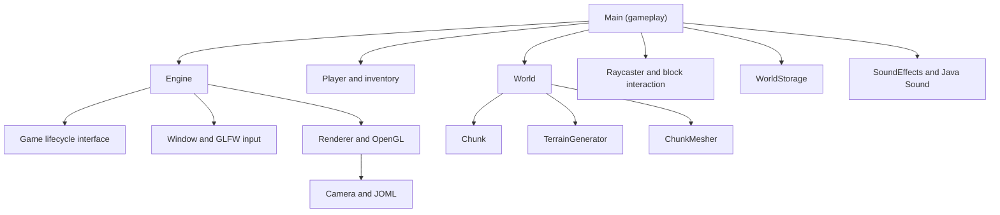
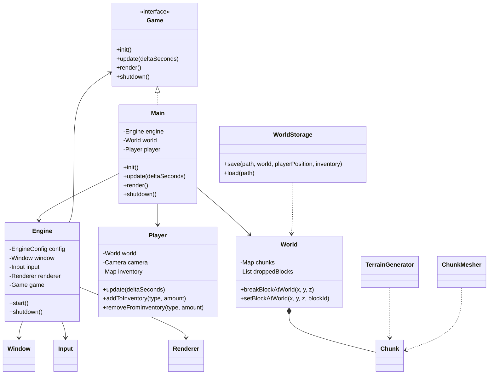

# BlocksBound Project Report

## 1. Identification of the Project (Project Title)

**Project title:** BlocksBound — a Java-based first-person voxel sandbox game and custom game engine.

BlocksBound applies Java programming to a real-time interactive 3D application. Players explore procedurally generated terrain, move through a block-based world, and interact with that world by breaking, collecting, and placing blocks.

## 2. Project Background

Voxel games represent a world as many small, block-shaped units. Building one combines several practical programming challenges: representing a large world efficiently, generating terrain, rendering 3D scenes, handling real-time input, and detecting collisions.

BlocksBound was created to explore these challenges through an original Java implementation. The current playable version concentrates on the core game loop: seeded terrain generation, chunk-based world storage, first-person movement, block interaction, inventory, sound effects, and local save/load. It is an early playable slice rather than the full set of ideas described as future goals.

## 3. Problem Statement

The project addresses the problem of building a playable voxel sandbox from the ground up while keeping world data, rendering, input, and gameplay responsibilities organized in a custom engine. It must generate and display terrain as the player explores, support reliable movement and block interaction, and preserve the player's progress between sessions.

## 4. Objectives of the Project

- Build a Java 21 application with a custom game engine and a real-time game loop.
- Generate deterministic terrain from a world seed, including mountain ridges and trees, and organize it into 16 × 64 × 16 chunks.
- Render the visible voxel terrain using LWJGL and OpenGL, rebuilding chunk meshes when edits make them stale.
- Support first-person mouse look, WASD movement, sprinting, jumping, gravity, and block collision.
- Let players target, break, collect, select, and place solid blocks.
- Save and restore the world, seed, player position, dropped blocks, and inventory using the current local binary save format.
- Cover core game logic with automated tests and identify features that still need manual testing.

## 5. System Design

### Overall Architecture

The game layer uses the engine's lifecycle contract. The engine coordinates timing, input, window management, rendering, and the game; game systems use the world, player, and persistence components.

### UML Class Diagram

This simplified diagram shows the main implementation relationships. `Main` implements the `Game` interface, while `Engine` receives a `Game` instance and invokes its lifecycle methods.

### World and Gameplay Flow

1. The engine initializes the game, window, input, and renderer.
2. The game loads the saved world if one exists; otherwise, it creates a seeded world and prepares nearby chunks.
3. Each fixed update handles player movement, chunk loading, block actions, and nearby drop collection.
4. The renderer draws nearby chunk meshes, the targeted block, and the hotbar.
5. Saving writes world and player state to the local binary save file.

## 6. Implementation of Object-Oriented Programming Concepts

- **Classes and objects:** The project models distinct responsibilities with classes such as `Engine`, `Player`, `World`, `Chunk`, `Renderer`, and `WorldStorage`. Runtime objects collaborate to run the game.
- **Encapsulation:** `Player` keeps its position, velocity, and inventory as private state and exposes methods for supported operations. Its inventory getter returns an unmodifiable copy rather than the internal map.
- **Abstraction:** The `Game` interface defines the lifecycle operations expected by the engine without coupling the engine loop to the details of the game implementation. Classes such as `WorldStorage` also provide focused operations for saving and loading.
- **Interfaces and polymorphism:** `Main` implements `Game`, and `Engine` works with a `Game` reference. This lets the engine invoke initialization, update, render, and shutdown through the interface contract.
- **Inheritance:** The current game code does not rely on a custom class inheritance hierarchy. It primarily uses composition and interface implementation; this is an intentional description of the current implementation, not a claim that class inheritance is demonstrated.

## 7. Implementation of Advanced Java Concepts

- **Exception handling:** Save/load operations use `IOException`; invalid state and configuration are rejected with appropriate exceptions. The engine performs resource cleanup during shutdown and preserves an existing failure if cleanup also fails.
- **Collections and generics:** Generic collections represent world chunks (`Map`), dropped blocks (`List`), and player inventory (`Map<BlockType, Integer>`). `Optional` communicates whether operations such as block targeting, breaking, or loading produced a result.
- **Java Streams:** Streams are not a notable part of the current implementation; ordinary collection operations and loops are used for gameplay and persistence.
- **Multithreading:** The current gameplay and rendering loop runs synchronously. No separate worker-thread system is implemented.
- **Persistence:** `WorldStorage` reads and writes a versioned binary file under the user's home directory (`~/.blocksbound/world.dat`). It includes a temporary-file-and-move strategy to reduce the chance of leaving a partially written save. JDBC/MySQL is not implemented.

## 8. Graphical User Interface (GUI)

BlocksBound is a real-time 3D game, not a Swing or JavaFX form-based application. It creates a desktop window through GLFW and renders the world and in-game HUD with LWJGL/OpenGL. The current interface includes a centered crosshair, targeted-block outline, and hotbar. The window title also reflects gameplay information.

### Current Controls

| Input | Action |
|---|---|
| WASD | Move |
| Mouse | Look around |
| Left Ctrl | Sprint |
| Space | Jump |
| Hold left mouse button for 0.5 seconds | Break one targeted block; release before breaking another |
| Right mouse button | Place the selected block if it is available in inventory |
| 1–6 | Select grass, dirt, stone, sand, wood, or leaves |
| F5 / F9 | Save / load |
| Escape | Exit; save on shutdown |

## 9. Database Connectivity

JDBC and a relational database are **not implemented** in the current project. World state is stored in a versioned local binary file instead. Database persistence is a possible future enhancement, not a current feature.

## 10. Source Code and Output Screenshots

- **Source code:** The Java application is under `src/main/java/com/blocksbound/`; automated tests are under `src/test/java/com/blocksbound/`.
- **Main class:** `com.blocksbound.game.Main`.
- **Screenshots:** No execution screenshots are currently included in this report. Add screenshots of the running game to document terrain rendering, the HUD/hotbar, block interaction, and save/load behavior when captures are available.

## 11. Testing and Results

The project uses Gradle and JUnit 5. The automated test suite covers:

- Engine configuration validation.
- Player collision behavior.
- Seeded terrain generation, mountain heights and tree placement, plus world systems including chunk meshing, negative-coordinate chunk borders, raycasting, block drops and pickups, and save/load.
- Block-break progress behavior.

These tests exercise core logic without replacing manual testing of the actual OpenGL window, visual rendering, audio output, or end-to-end play on a compatible system. Run the tests with `.\gradlew.bat test`. The build targets Java 21; run the game with `.\gradlew.bat run`.

## 12. Conclusion and Future Enhancements

BlocksBound currently demonstrates a playable core for a Java voxel sandbox: procedural chunked terrain, first-person movement and collision, block interaction, inventory, audio effects, OpenGL rendering, and local world persistence. The modular engine/game structure also provides a foundation for extending the project.

Potential future work includes adding biomes, textures, crafting, enemies and health, a menu and settings flow, JDBC-backed persistence, and expanded automated and manual testing. These are future enhancements and are not represented as completed features in this report.
