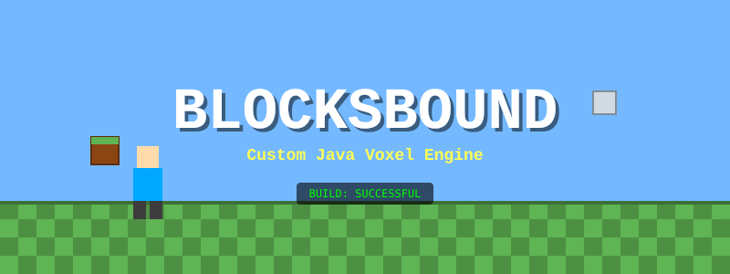



  

---

📌 Project Overview

This project is a 3D voxel-based sandbox game inspired by the fundamental concepts of games such as Minecraft, while being an original implementation with its own world, mechanics, visuals, and gameplay systems.

The project will be built using Java and LWJGL/OpenGL, with a custom voxel engine developed specifically for this game.

The objective is not to recreate Minecraft itself, but to understand and implement the fundamental technologies behind a voxel-based 3D game:

- Real-time 3D rendering
- OpenGL graphics programming
- Voxel-based world representation
- Chunk-based world management
- Procedural terrain generation
- Mesh generation
- Collision detection
- Player physics
- Raycasting
- Entity systems
- Inventory and crafting
- Game state management
- Database persistence using JDBC and MySQL

The engine and game will be developed together, with the engine providing the technical foundation and the game providing the gameplay layer.

---

🎯 Project Goals

Primary Goals

- Build a functioning custom 3D voxel engine.
- Render a large block-based world efficiently.
- Implement procedural terrain generation.
- Implement first-person player movement.
- Implement block breaking and placement.
- Implement physics and collision detection.
- Implement basic entities and enemy behavior.
- Implement inventory and crafting systems.
- Implement save/load functionality.
- Integrate JDBC and MySQL for persistent game data.
- Produce a polished, playable final game.

Technical Goals

The project should demonstrate practical knowledge of:

- Java OOP
- Data structures
- Computer graphics
- OpenGL
- Game loops
- Algorithms
- Physics
- Procedural generation
- Memory/performance optimization
- Database design
- JDBC
- Software architecture
- Git/GitHub collaboration

---

🎮 Current Playable Slice

The current build implements the first playable voxel-world loop:

- Deterministic, seeded terrain generated into 16 × 64 × 16 chunks as the player explores.
- Chunk meshes include only faces exposed to air or water; edits refresh the affected chunk meshes.
- First-person WASD movement with mouse look, gravity, jumping, and block collision.
- Locally synthesized sound effects for jumping, breaking and placing blocks, and collecting drops.
- A centered crosshair and outline highlight the block being targeted; hold the left mouse button for 0.5 seconds to break one block, then release before breaking another, or use the right mouse button to place the selected block.
- Number keys 1–6 select grass, dirt, stone, sand, wood, or leaves.
- F5 saves the world and player position; F9 loads the save; Escape exits (and saves on shutdown).
- Saves are stored locally at `.blocksbound/world.dat` under the user's home directory. This binary save is the current persistence implementation; JDBC/MySQL remains a future project goal.

---

🏗️ High-Level Architecture

                    ┌─────────────────────┐
                    │       GAME          │
                    │                     │
                    │ Player              │
                    │ Inventory           │
                    │ Crafting             │
                    │ Entities             │
                    │ Game Rules           │
                    └──────────┬──────────┘
                               │
                               ▼
                    ┌─────────────────────┐
                    │   VOXEL ENGINE      │
                    │                     │
                    │ Game Loop           │
                    │ Rendering           │
                    │ World               │
                    │ Chunk System        │
                    │ Physics             │
                    │ Input               │
                    │ Audio               │
                    └──────────┬──────────┘
                               │
                 ┌─────────────┼─────────────┐
                 ▼             ▼             ▼
             OpenGL          LWJGL          JOML
                 │
                 ▼
             GPU / OS
                 
                    ┌─────────────────────┐
                    │    SAVE SYSTEM      │
                    │                     │
                    │ JDBC                │
                    │ MySQL               │
                    └─────────────────────┘

---

  

---

🧱 Engine Components

The engine will be developed specifically for this game.

1. Core

Responsible for the fundamental application lifecycle.

Engine
 ├── Game Loop
 ├── Window
 ├── Time
 ├── Input
 └── Application State

---

2. Rendering System

Responsible for rendering the 3D world.

Renderer
 ├── OpenGL initialization
 ├── Shaders
 ├── VAO / VBO
 ├── Meshes
 ├── Textures
 ├── Camera
 └── Render pipeline

---

3. Voxel World

The world will be represented using blocks organized into chunks.

World
 │
 ├── Chunk
 │    ├── Blocks
 │    └── Chunk Mesh
 │
 ├── Chunk
 │
 └── Chunk

Initial target:

Chunk size: 16 × 64 × 16

The dimensions may be modified during optimization.

---

4. Block System

Initial block types may include:

AIR
GRASS
DIRT
STONE
SAND
WOOD
LEAVES
WATER

Additional blocks will be added as gameplay requirements develop.

---

5. Chunk Meshing

The engine will avoid rendering invisible block faces.

Conceptually:

Block
  ↓
Check neighboring blocks
  ↓
Visible faces only
  ↓
Generate mesh
  ↓
Upload mesh to GPU
  ↓
Render

Future optimization may include greedy meshing or other mesh optimization techniques.

---

6. Procedural World Generation

The world will be generated using deterministic procedural algorithms.

The same world seed should produce the same world.

Potential generation stages:

Seed
 ↓
Terrain Height
 ↓
Biome Selection
 ↓
Terrain Blocks
 ↓
Trees
 ↓
Ores
 ↓
Caves
 ↓
Structures

---

7. Player System

The player system will contain:

- Position
- Rotation
- Velocity
- Camera
- Collision box
- Gravity
- Jumping
- Movement
- Health
- Damage
- Interaction

---

8. Raycasting

Raycasting will be used to determine which block the player is looking at.

Player
   │
   │ Ray
   │
   └────────────────────► Block
                            │
                            ▼
                       Selected Block

This will allow:

- Block breaking
- Block placement
- Interaction
- Object selection

---

🎮 Game Systems

Once the engine foundation is stable, game systems will be implemented.

Planned systems

- Player
- Inventory
- Hotbar
- Crafting
- Tools
- Items
- Health
- Enemies
- Basic AI
- Day/night cycle
- World exploration
- Resource collection
- Save/load
- Audio
- Main menu
- Settings

---
📏 Project Scope

The project will prioritize quality over quantity.

The first release will focus on a stable core experience rather than attempting to reproduce every feature of Minecraft.

Minimum viable game

The final minimum target is:

Launch
  ↓
Create World
  ↓
Generate Terrain
  ↓
Explore
  ↓
Break Blocks
  ↓
Place Blocks
  ↓
Collect Resources
  ↓
Craft Items
  ↓
Interact With Entities
  ↓
Save
  ↓
Exit
  ↓
Reload

Additional features will only be added after the core game is stable.

---

⚡ Performance Goals

Performance will be considered during engine development rather than after the entire game is finished.

Potential optimization areas:

- Chunk meshing
- Frustum culling
- Chunk loading/unloading
- Face culling
- Mesh batching
- Texture atlasing
- Memory management
- GPU utilization
- Background chunk generation

Optimization should be based on profiling rather than assumptions.

---

📚 Engineering Principles

1. Build incrementally

Do not implement multiple major systems simultaneously.

2. Keep systems modular

Renderer ≠ World Generator
World ≠ Inventory
Inventory ≠ Database

3. Prefer clear code over clever code

The project should be understandable by every team member.

4. Test difficult systems independently

Especially:

- Chunk generation
- Collision
- Raycasting
- Mesh generation
- Save/load

5. Don't optimize blindly

Measure performance first.

6. Protect the engine

The engine is the foundation of the game. Changes to core rendering/world systems should be reviewed carefully

---

🚧 Current Status

Project initialized.

Current objective:

«Establish the Java/LWJGL development environment and create the first working OpenGL window.»

First milestone

Java
 ↓
LWJGL
 ↓
GLFW
 ↓
OpenGL
 ↓
Window
 ↓
Game Loop

---

📜 Project Philosophy

This project is not intended to be a Minecraft clone.

The goal is to learn by building a complete 3D software system from the ground up.

Every major subsystem should exist because the team understands why it is needed and how it works.

The engine should remain simple enough to understand, powerful enough to run the game, and modular enough to evolve throughout development.

---

  

---

Project Start: September 2026
Target Completion: November 2026

«Build the engine. Build the world. Build the game.»
